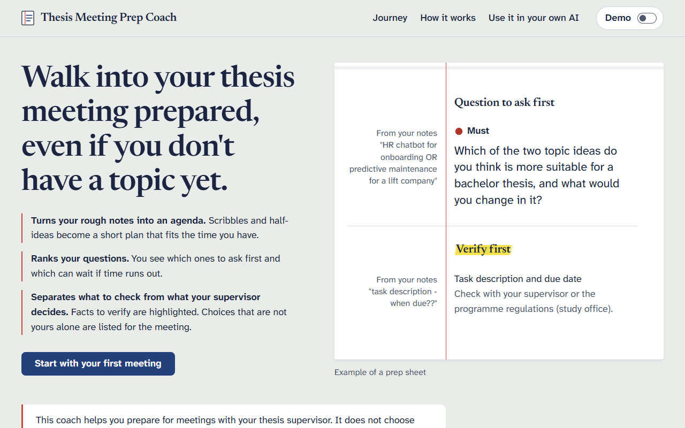
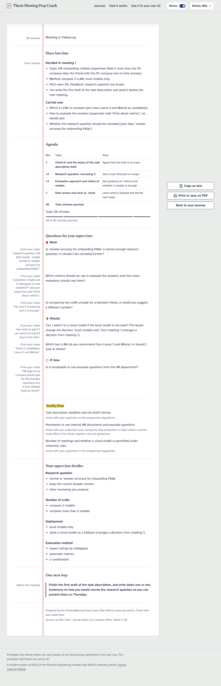
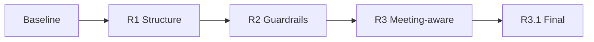
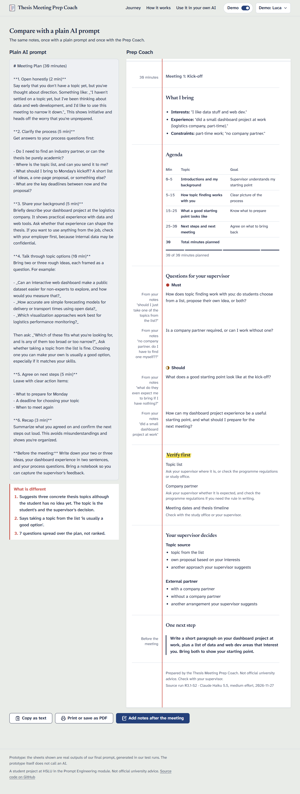

# Thesis Meeting Prep Coach

Turn messy notes into a one-page prep sheet for your next thesis supervisor meeting, even if you don't have a topic yet.

[](https://github.com/aaron-binzegger/thesis-meeting-prep-coach/actions/workflows/ci.yml)
[](https://github.com/aaron-binzegger/thesis-meeting-prep-coach/actions/workflows/deploy.yml)
[](LICENSE)

**Live demo:** https://aaron-binzegger.github.io/thesis-meeting-prep-coach/



> Student project at HSLU. This is **not official HSLU advice**, and the app uses no HSLU branding.

## The problem

Students arrive at thesis meetings with messy notes, forget questions and leave without clear next steps.

## What the coach does

The coach is a prompt. You give it your rough notes, and it hands back a one-page prep sheet that you and your supervisor can check. It:

- turns your notes into an **agenda** that fits the time you have
- **ranks your questions** (Must / Should / If time)
- builds a **"Verify first"** list for rules and dates it never states itself
- lists what **your supervisor decides**
- suggests **one next step**

## Focus: the first two meetings

- **Kick-off:** turns first ideas and open questions into a clear agenda.
- **No idea yet:** students without a topic get a "What I bring" block (interests, experience, constraints) instead of topic suggestions. The topic stays the student's and the supervisor's decision.
- **Second meeting with context:** the notes from meeting 1 carry over. The sheet starts with "Since last time" (decided / carried over), so decisions are not reopened by accident.

Later meetings (regular, mid-term, pre-submission) are shown for context. The pre-submission example is a real test output.



## How it works



- **Baseline:** "Make a meeting plan from these notes"
- **R1 Structure:** role, format, max. 6 ranked, traceable questions
- **R2 Guardrails:** no institutional facts, _Verify first_, _Supervisor decides_
- **R3 Meeting-aware:** "What I bring" (no idea yet), _Since last time_, clarifying step
- **R3.1 Final:** 5 targeted fixes from R3

Every prompt version is in [`docs/prompts/`](docs/prompts/). If the notes are too thin, the coach first asks clarifying questions; otherwise it writes the sheet. The student and the supervisor check it.

> Prototype: the sheets shown are real outputs of our final prompt, generated in our test runs. The prototype itself does not call an AI.



## Use it in your own AI

The coach works in any AI chat tool. [`docs/skill/`](docs/skill/) has:

- [`copy-paste-prompt.md`](docs/skill/copy-paste-prompt.md): the prompt for any AI chat, with notes for a ChatGPT custom GPT or a Gemini Gem
- [`thesis-meeting-prep-coach/SKILL.md`](docs/skill/thesis-meeting-prep-coach/SKILL.md): the same coach as a Claude skill

The app's "Use it in your own AI" page shows the prompt with a copy button and offers `SKILL.md` as a download.

## Evaluation in short

- The baseline ("Make a meeting plan from these notes") passed the hard criteria in 1 / 6 runs. It **suggests three thesis topics to a student who has none**.
- **No institutional facts in any of 27 runs** of R2–R3.1, including the stress tests and the ChatGPT/Gemini runs.
- R3.1 Final: 4 / 7 hard passes (stress 3 / 3, ChatGPT/Gemini 3 / 4), soft average 2.96.
- **Limitation (decision blind spot):** when the student doubts a decision indirectly ("not sure if comparing just 2 is enough"), Haiku never marks it as questioning the meeting-1 decision. Model capability matters here, not only the prompt.

Setup, rubric, all results and where it does not work: [`docs/evaluation.md`](docs/evaluation.md). The peer test with classmates is still running; its results will be added there.

## Prototype limitations

- The outputs are **pre-generated**; there is **no live AI** call. Notes you type yourself get the sheet of a similar fictional student, marked as an example.
- All personas and notes are **fictional**.
- The sheets are shown exactly as the model wrote them, including the weaknesses described in [`docs/evaluation.md`](docs/evaluation.md).
- This is a student project, **not official HSLU advice**.

## Run locally

Requirements: Node.js 20 or newer.

```sh
npm install
npm run dev
```

| Script                 | What it does                                  |
| ---------------------- | --------------------------------------------- |
| `npm run dev`          | Start the dev server                          |
| `npm run build`        | Typecheck and build the static site to `dist` |
| `npm run preview`      | Serve the production build locally            |
| `npm run lint`         | Run ESLint                                    |
| `npm run format`       | Format all files with Prettier                |
| `npm run format:check` | Check formatting without writing              |
| `npm run typecheck`    | Run the TypeScript compiler without emitting  |
| `npm run test`         | Run the Vitest test suite once                |
| `npm run test:watch`   | Run Vitest in watch mode                      |

## Project structure

```
src/
├─ pages/        one folder per screen
├─ components/   prep sheet, compare view, demo panel, shared UI
├─ data/         personas, scenarios, sheets/*.json, evaluation summary
├─ types/        data model (prep-sheet.ts)
├─ state/        in-memory session (no browser storage)
├─ styles/       tokens, global and print styles
├─ App.tsx       routes (HashRouter)
└─ main.tsx      entry point
data-source/     verbatim test outputs (coach runs and baselines)
docs/            spec, prompts, skill, evaluation, AI-use disclosure, screenshots
.github/         CI, deploy workflow, PR template
```

## Responsible use and privacy

- Don't enter real names, grades or confidential company data.
- The app runs entirely in your browser. It stores nothing and sends nothing.
- The sheet is a starting point. You and your supervisor check it, and your supervisor has the final say on what happens in your thesis.
- The coach never states university rules, dates or deadlines. It lists them under "Verify first" for you to check with your supervisor or in your programme's regulations.

## AI use

We tested the prompt with Claude Haiku 5.5, ChatGPT and Gemini; the sheets in the app are verbatim test outputs. Claude helped with planning, test materials, pre-scoring and drafting, and we checked every score and text. The app code was written with **Claude Code**. Details: [`docs/ai-use-disclosure.md`](docs/ai-use-disclosure.md).

## Authors

- Aaron Binzegger
- Darvin Windlin

Final project of the module _Prompt Engineering_, student project at HSLU, autumn semester 2026.

Licensed under the [MIT License](LICENSE).
